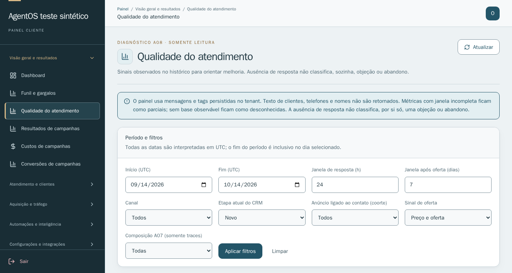
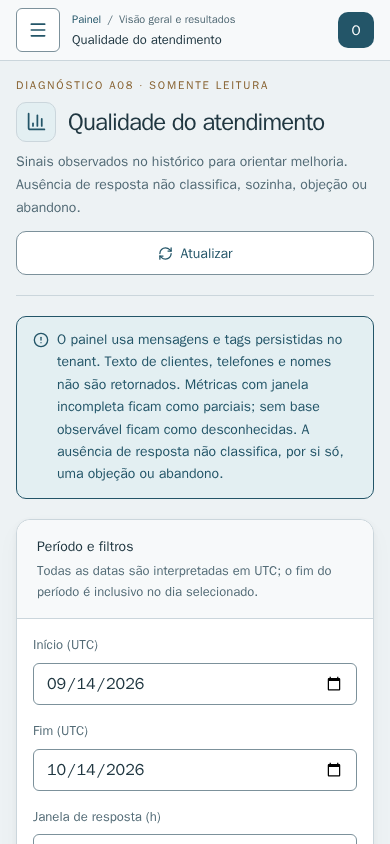

# A08 — Final da candidata local

**Status:** pronta para revisão e aprovação de release; não implantada.

**Repositório/branch:** `ferriolimidias/agenteos`, `feat/a08-quality-20261014`.

**Baseline:** `8ba952c1aee595d289a98f25999ce0734ff5003b`.

## Resultado

- `A08_IMPLEMENTED=YES` — painel tenant-scoped de leitura em `/painel/qualidade`, API autenticada de métricas e drill-down, estados de cobertura explícitos, filtros, oportunidades e links para evidências no Inbox.
- `METRICS=perguntas sem resposta observada (inbound com “?” / inbound maduro); sem continuidade após preço/oferta (outbound com marcador / sinal maduro); cobertura de resposta (inbound respondido / inbound maduro); mediana da primeira resposta (pares respondidos usados na mediana); tags explícitas de objeção (eventos e leads distintos); traces A07 (execuções, latência e uso medido por composição).`
- `DATA_COVERAGE=mensagens persistidas em janela UTC; projeções SQL compactas sem texto nem JSON de mensagem; limite de 100.000 mensagens mais sentinela; estados observed/partial/unknown/not_applicable; contatos distintos por UUID CRMLead; tags de objeção explícitas; etapa é snapshot atual do CRM; anúncio é coorte sem vínculo causal; A07 não contém versão exata de prompt nem vínculo com conversa; horizonte de traces de 7 dias.`
- `BACKEND_TESTS=20 focados A08 aprovados; suíte completa 1.411 aprovados, 115 ignorados, 20 falhas históricas.`
- `FRONTEND_TESTS=build e artefatos aprovados; ESLint 0 erros e 5 avisos; 130 testes Node aprovados; browser sintético em 1327×709 e 390×844 sem overflow, GET-only, 1 raiz React, sem erros; smoke amplo de páginas aprovado.`
- `PROTECTED_BASELINES=14/14 PASS.`
- `NEW_REGRESSIONS=0` — comparação entre baseline limpo e candidata: os mesmos 20 IDs de falha na suíte backend; nenhuma falha nova ou resolvida. Os logs completos de teste permanecem em `/tmp/agenteos-a08-validation/` e não foram copiados para o repositório.
- `SECURITY_REVIEW=PASS` — revisões independentes de release e segurança aprovadas; API GET autenticada, isolamento por empresa, nenhum texto ou dado de contato no payload de evidência. Risco residual P2: até 100.001 projeções compactas e evidências intermediárias podem ser materializadas antes da paginação; não houve teste de carga em banco de produção.
- `PRODUCTION_UNCHANGED=YES` — nenhum deploy, alteração de runtime, schema, banco, Redis ou serviço de produção. Não houve operação comercial real.
- `READY_FOR_DEPLOY=YES, após aprovação do operador.`

## Evidência visual sintética

As capturas usam somente fixtures e APIs interceptadas; não contêm dados reais.

## Registro operacional

| Campo do protocolo | Valor |
| --- | --- |
| `STATUS` | Candidata local concluída; aguardando revisão/aprovação para release |
| `project` | `ferriolimidias/agenteos` |
| `objective` | Diagnóstico objetivo da qualidade do atendimento, sem classificação fictícia |
| `root_cause` | Não aplicável: funcionalidade nova, sem incidente corrigido |
| `evidence` | Testes sintéticos, comparação de baseline, revisão independente e capturas acima |
| `task_files` | `app/api/routers/analytics.py`; `app/services/attendance_quality.py`; `frontend/src/App.jsx`; navegação tenant; painel A08; testes A08; documentação |
| `unrelated_changes_excluded` | Sim; somente worktree candidato foi alterado; checkout principal histórico permaneceu intacto |
| `backup_path` | Sem backup de runtime necessário; reversão de código ao baseline `8ba952c1aee595d289a98f25999ce0734ff5003b` |
| `tests` | 20 focados; 1.411 passes, 115 skips, mesmos 20 failures do baseline; frontend 130 passes; browser sintético e smoke amplo passam |
| `focused_review` | Aprovada por revisores independentes de release e segurança |
| `migration` | Nenhuma |
| `rows_before` / `rows_after` | Não aplicável; sem escrita ou alteração de dados |
| `runtime_before` / `runtime_after` | Produção inalterada |
| `services_changed` | Código candidato somente; nenhum serviço de produção |
| `services_preserved` | Inbox #29/#30, CRM #23, A07 em LEGACY, JEV e integrações externas |
| `health` | Não revalidada em produção porque não houve deploy; sem mudança de produção |
| `protected_regressions` | 14 baselines protegidos aprovados; zero novas falhas comparadas ao baseline |
| `external_action_performed` | Nenhuma ação de produção; comentário de progresso autorizado na Issue #9 após registro do commit |
| `real_test_performed` | Não; somente dados sintéticos e APIs interceptadas |
| `rollback_required` | Não houve deploy; reversão de código para o baseline documentado, sem migration |
| `next_action` | Revisão/aprovação do operador antes de qualquer deploy |
| `report_path` | `reports/a08-attendance-quality-20261014/REPORT.md` |
